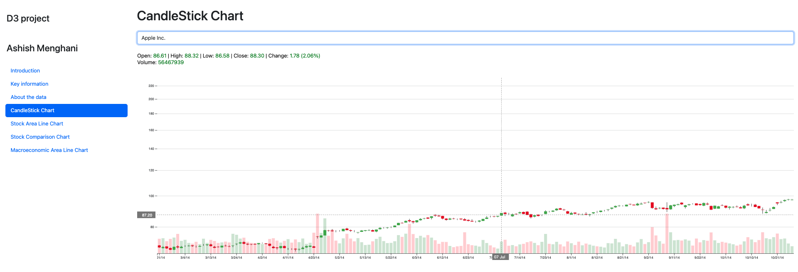
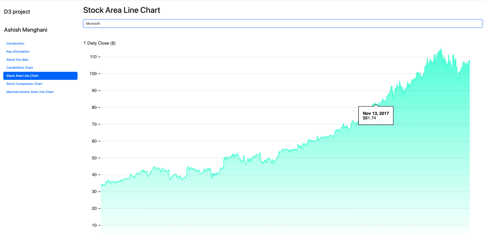
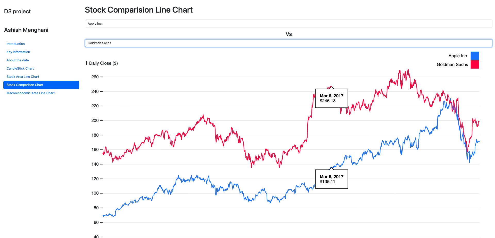
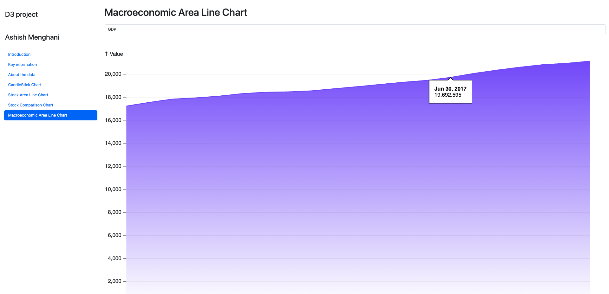

# DJIA Financial Visualisation Dashboard

<div align="center">


**Browser-based interactive financial analytics dashboard — 4 chart types covering 30 DJIA stocks (2014–2019), plus a separate FRED macroeconomic chart. Hand-coded in D3.js v7 with no charting library or build tooling.**

[Live Demo](#-live-demo) · [Chart Types](#-chart-types) · [Dataset](#-dataset) · [How to Run](#-how-to-run)

</div>

---

## Overview

This project engineers an interactive, multi-chart financial data visualisation system using **D3.js v7** to answer four analytical research questions about Dow Jones Industrial Average (DJIA) constituent stocks. Each of the four visualisations addresses a distinct question, from daily price structure to macroeconomic context, and is implemented as a self-contained, browser-renderable HTML page with no build tooling, no Node.js, and no server required.

The application is built entirely with **vanilla JavaScript + D3.js v7 + Bootstrap 5.3.3**, demonstrating proficiency in the core DOM manipulation, SVG rendering, and data binding patterns that underpin modern data visualisation frameworks. All chart interactivity — crosshairs, hover tooltips, dual-series synchronisation, and dynamic OHLCV readouts is implemented from first principles without charting library abstractions.

Built for the King's College London module Introduction to Data Visualisation (2023).

**Research questions addressed:**

| Chart | Research Question |
|---|---|
| Candlestick | Q2: Can historical price patterns indicate future price movement? |
| Area Line | Q1: What performance trends are detectable in DJIA stocks over 5 years? |
| Comparison Line | Q3: How do two DJIA stocks compare against each other over time? |
| Macroeconomic | Q4: How do GDP, interest rates, and unemployment correlate with DJIA prices? |

---

## Live Demo

> **GitHub Pages:** [ashishmenghani27.github.io/djia-financial-visualisation](https://ashishmenghani27.github.io/djia-financial-visualisation)

Open `index.html` locally — or visit the GitHub Pages URL above — to access all four charts via the left-side navigation panel. No installation, no dependencies to install.

---

## Chart Types

### Chart 1 — Candlestick Chart

> *Q2: Analyse possible price movements based on past patterns.*

**File:** `html/CandleStick.html` | `javascript/candlestick.js`

The candlestick chart displays the full OHLCV (Open, High, Low, Close, Volume) structure for any of the 30 DJIA constituents across the complete 2014–2019 period (1,257 trading days). Volume bars are rendered as semi-transparent overlays behind the candlestick bodies.

**D3.js implementation details:**
- `d3.scaleBand()` for x-axis — correct for discrete trading-day positioning (avoids weekend/holiday gaps that `scaleTime()` would introduce)
- `d3.scaleLog()` for y-axis — logarithmic price scale, appropriate for multi-year percentage return comparison
- Canvas width: 13,920px (928px × 15) with horizontal scroll — fits all 1,257 candles at readable resolution
- Tick labelling: every 7th data point to prevent x-axis crowding
- Candle colour: green = close > open; red = open > close (`d3.schemeSet1` palette)

**Interactivity:**
- Crosshair lines (X + Y, dashed grey) snap to nearest trading day on mousemove
- Dynamic header updates with `Open | High | Low | Close | Change (%) | Volume` for the hovered candle
- Values colour-coded green/red matching the candle direction



---

### Chart 2 — Stock Area Line Chart

> *Q1: Analyse stock performance trends over time.*

**File:** `html/LineChart.html` | `javascript/linechart.js`

An area line chart displaying daily closing prices for a selected DJIA stock across the full 5-year window. The shaded area fill uses a randomised gradient (from 4-colour palette: purple, blue, red, teal) generated fresh on each page load, with gradient opacity fading to zero at the baseline.

**D3.js implementation details:**
- `d3.scaleUtc()` for x-axis — proper continuous temporal scale
- `d3.area()` + `d3.line()` combination — area generator fills below the line to zero baseline
- `clipPath` applied to prevent area overflow at chart boundaries
- Random gradient: `["#7C4DFF", "#448AFF", "#FF5252", "#64FFDA"]` — creates visual variety across stocks

**Interactivity:**
- `d3.bisector()` for nearest-point hover detection
- Custom callout balloon tooltip (hand-drawn SVG path) displaying date + USD-formatted close price
- Tooltip repositions dynamically as pointer moves



---

### Chart 3 — Stock Comparison Chart

> *Q3: Compare the performance of two DJIA stocks over the same period.*

**File:** `html/ComparisionChart.html` | `javascript/comparision.js`

A dual-series line chart that loads two user-selected DJIA stocks simultaneously via `Promise.all()` and renders them on a shared y-axis with a combined domain. The chart directly answers whether one stock outperformed another over any stretch of the 2014–2019 window.

**D3.js implementation details:**
- `Promise.all([loadChart(file1, 1), loadChart(file2, 2)])` — concurrent async data loading
- Combined domain: `d3.max([...ticker1.map(d=>d.Close), ...ticker2.map(d=>d.Close)])` — both series always visible without clipping
- Line 1: `#2979FF` (blue); Line 2: `#FF1744` (red) — perceptually distinct, colourblind-accessible pair
- Legend: dynamically reads company names from dropdown `selectedOptions` text

**Interactivity:**
- Two simultaneous independent callout tooltips — one per series — both render at the same x-position but at each stock's respective y-price
- Both tooltips update synchronously as the pointer moves
- Two independent dropdowns: any of 30 stocks can be selected for either series



---

### Chart 4 — Macroeconomic Area Line Chart

> *Q4: How do macroeconomic indicators influence DJIA stocks?*

**File:** `html/LineChart2.html` | `javascript/linechart2.js`

An area line chart rendering FRED macroeconomic time series data. Users select from three indicators via dropdown: GDP, short-term interest rates, or unemployment rate. The chart uses the same gradient-area architecture as Chart 2 but maps to the FRED CSV schema (`DATE`, `DATA` columns) — making it reusable for any future FRED indicator.

**FRED indicators included:**

| Indicator | Frequency | Date Range | Range |
|---|---|---|---|
| GDP (Nominal, $B) | Quarterly | 2014-Q1 → 2019-Q1 | $17,198B → $21,104B |
| Interest Rate (%) | Monthly | Feb 2014 → Mar 2019 | 0.51% → 1.07% |
| Unemployment Rate (%) | Monthly | Feb 2014 → Mar 2019 | 3.8% → 6.7% |

**Source:** [Federal Reserve Economic Data (FRED)](https://fred.stlouisfed.org/) — public domain.

**D3.js implementation details:**
- `d3.timeParse("%Y-%m-%d")` for FRED date format
- Generic `Value` field mapping — one chart function handles all three macro series
- Same callout tooltip pattern as Chart 2



---

## Key Findings

Observations surfaced by interacting with the four charts:

**Price trends (Chart 1 + 2):**
- Boeing (BA) exhibited the strongest absolute price growth: from $112.89 in Feb 2014 to a peak of $421.55, a 3.73× price increase over 5 years
- Apple (AAPL) reached a peak close of $230.28 before a sharp Q4 2018 correction visible in both candlestick and area line views
- Goldman Sachs (GS) and UnitedHealth (UNH) show the clearest bull-market staircase pattern on the candlestick chart
- Coca-Cola (KO) shows the flattest price trajectory — consistent with its defensive equity profile

**Cross-stock comparison (Chart 3):**
- AAPL and MSFT diverge upward from XOM and IBM from 2017 onward in raw price terms
- DWDP (DowDuPont merger) only has data from September 2017; selecting it against a full-history stock highlights the merger formation date as a structural breakpoint

**Macroeconomic context (Chart 4):**
- GDP grew continuously from $17.2T to $21.1T across the period — a 22.7% expansion
- Unemployment fell from 6.7% in Feb 2014 to 3.8% by early 2019 — a 2.9 percentage point decline consistent with the post-2008 recovery
- Short-term interest rates rose from 0.51% to 1.07% across the period, reflecting gradual Fed tightening

---

## Dataset

### DJIA Stock Data

**Source:** IEX Exchange / Yahoo Finance — end-of-day, split and dividend adjusted  
**Period:** 2014-02-21 → 2019-02-20 (5 years, 1,257 trading days)  
**Coverage:** All 30 DJIA constituents as of the data collection date

**CSV schema (per ticker file):**
```
date, open, high, low, close, volume, unadjustedVolume,
change, changePercent, vwap, label, changeOverTime
```

**All 30 tickers:**

| Ticker | Company | Ticker | Company |
|---|---|---|---|
| AAPL | Apple Inc. | MCD | McDonald's |
| AXP | American Express | MMM | 3M |
| BA | Boeing | MRK | Merck & Co. |
| CAT | Caterpillar | MSFT | Microsoft |
| CSCO | Cisco Systems | NKE | Nike |
| CVX | Chevron | PFE | Pfizer |
| DIS | Walt Disney | PG | Procter & Gamble |
| DWDP | DowDuPont* | TRV | Travelers |
| GS | Goldman Sachs | UNH | UnitedHealth Group |
| HD | Home Depot | UTX | United Technologies |
| IBM | IBM | V | Visa |
| INTC | Intel | VZ | Verizon |
| JNJ | Johnson & Johnson | WBA | Walgreens Boots Alliance |
| JPM | JPMorgan Chase | WMT | Walmart |
| KO | Coca-Cola | XOM | ExxonMobil |

*DWDP (DowDuPont): 367 trading days only — formed from Dow Chemical / DuPont merger, began trading September 2017.

**To fetch fresh data using yfinance:**
```bash
pip install yfinance pandas
python scripts/fetch_djia_data.py
```
This downloads all 30 tickers from Yahoo Finance and saves them to `Data/` in the required CSV format.

### Macroeconomic Data

**Source:** [Federal Reserve Economic Data (FRED)](https://fred.stlouisfed.org/)  
**Licence:** Public domain — freely redistributable  
**Location:** `Macro data/` directory

---

## Tech Stack

| Technology | Version | Role |
|---|---|---|
| D3.js | v7 (CDN) | All chart rendering, scales, axes, interactivity |
| Bootstrap | 5.3.3 (CDN) | Layout, navbar, responsive grid, dropdowns |
| Bootstrap Icons | Latest (CDN) | Navigation icons |
| Vanilla JavaScript | ES6+ | Data loading, event handling, chart orchestration |
| HTML5 | — | Page structure, SVG containers |
| CSS3 | — | Responsive chart sizing (minimal custom styles) |

**Zero build tooling.** No webpack, no npm, no transpilation. Open `index.html` in a browser and it works.

---

## Project Structure

```
djia-financial-visualisation/
├── index.html                       # Landing page: intro, research questions, navbar
├── html/
│   ├── CandleStick.html             # Chart 1: OHLCV candlestick with crosshair
│   ├── LineChart.html               # Chart 2: Stock area line with tooltip
│   ├── ComparisionChart.html        # Chart 3: Dual-series comparison (note: typo preserved)
│   └── LineChart2.html              # Chart 4: Macroeconomic area line
├── javascript/
│   ├── candlestick.js               # Candlestick chart: scaleBand, scaleLog, volume overlay
│   ├── linechart.js                 # Area line chart: scaleUtc, area + line generators
│   ├── comparision.js               # Comparison chart: Promise.all, dual tooltips
│   ├── linechart2.js                # Macro chart: FRED CSV parser, generic Value mapping
│   └── script.js                    # Navbar active-state management
├── css/
│   └── style.css                    # Minimal custom styles (responsive chart sizing)
├── Data/
│   ├── AAPL.csv                     # Apple — 1,257 rows, 2014-02-21 → 2019-02-20
│   ├── AXP.csv                      # American Express
│   ├── BA.csv                       # Boeing
│   ├── ... (27 more tickers)
│   └── XOM.csv                      # ExxonMobil
├── Macro data/
│   ├── GDP.csv                      # Quarterly GDP 2014-Q1 → 2019-Q1 (FRED, public domain)
│   ├── 10-Year Interest Rate.csv    # Monthly interest-rate series, Feb 2014 → Mar 2019 (FRED)
│   └── Unemployment Rate.csv        # Monthly unemployment Feb 2014 → Mar 2019
├── scripts/
│   └── fetch_djia_data.py           # yfinance script to refresh DJIA stock data
├── docs/
│   └── screenshots/                 # Chart screenshots for README
├── .gitignore
├── LICENSE
└── README.md
```

---

## How to Run

### Option 1 — Open Directly (Instant, No Setup)

```bash
# Clone the repo
git clone https://github.com/AshishMenghani27/djia-financial-visualisation.git
cd djia-financial-visualisation

# Open in browser — macOS
open index.html

# Open in browser — Windows
start index.html

# Open in browser — Linux
xdg-open index.html
```

Navigate using the left-side panel: Introduction → Chart pages.

> ⚠️ Some browsers block local file CORS requests needed for CSV loading. If charts appear blank when opened via `file://`, use Option 2.

### Option 2 — Local HTTP Server (Recommended)

```bash
# Python (no install required)
python3 -m http.server 8080

# Then open: http://localhost:8080
```

Or install the [VS Code Live Server extension](https://marketplace.visualstudio.com/items?itemName=ritwickdey.LiveServer) and click **Go Live** from `index.html`.

### Option 3 — Live Demo (No Setup At All)

Visit the GitHub Pages deployment: [ashishmenghani27.github.io/djia-financial-visualisation](https://ashishmenghani27.github.io/djia-financial-visualisation)

---

## Refreshing the Stock Data

The included CSVs cover 2014-02-21 → 2019-02-20. To download fresh or extended data:

```bash
pip install yfinance pandas
python scripts/fetch_djia_data.py
```

The script downloads all 30 DJIA tickers from Yahoo Finance and saves them to `Data/` in the exact CSV format the charts expect.

---

## Design Decisions

**Why `scaleBand` for the candlestick x-axis (not `scaleTime`)?**  
`scaleTime` would introduce visual gaps for weekends and market holidays — the x-axis would have blank space where no trading occurred. `scaleBand` treats each trading day as an equal-width discrete band, which is the industry-standard rendering for candlestick charts.

**Why `scaleLog` for the candlestick y-axis?**  
A logarithmic scale correctly represents percentage returns — a move from $100 to $110 (10%) occupies the same vertical space as a move from $1,000 to $1,100 (also 10%). This is standard practice for multi-year financial charts.

**Why no charting library (Chart.js, Plotly, Highcharts)?**  
Using D3.js v7 directly demonstrates understanding of SVG data binding, scale construction, and event-driven interactivity at the primitive level — skills directly transferable to custom visualisation engineering roles. Libraries abstract this complexity away; this implementation exposes it deliberately.

**Why random gradient on area charts?**  
Each stock load randomises the gradient colour from a curated 4-colour palette. This creates visual distinctiveness when switching between stocks without requiring manual colour mapping for 30 tickers.

---

## Limitations

- **No time-period filter:** Charts always render the full 2014–2019 window; a brush/zoom component would enable sub-period analysis
- **Macro charts are standalone:** Chart 4 renders macro indicators independently; a dual-axis overlay combining stock prices with macro data on the same chart would strengthen the Q4 analysis
- **DWDP partial data:** DowDuPont only has data from September 2017 onward; this causes an asymmetric comparison in Chart 3 when paired against a full-history stock
- **No mobile optimisation for candlestick:** The horizontal scroll canvas (13,920px) is functional on desktop but suboptimal on mobile screens

---

## Future Extensions

- **Brush + zoom:** Add `d3.brushX()` to Area Line and Candlestick charts for interactive time-period selection
- **Dual-axis macro overlay:** Combine stock close price (left y-axis) with a macro indicator (right y-axis) on the same chart to directly answer Q4 visually
- **Portfolio returns calculator:** Add a panel computing percentage return and volatility for any selected stock + time window
- **Real-time data:** Swap static CSVs for Yahoo Finance or Alpha Vantage API calls

---

## References

- Bostock, M., Ogievetsky, V., & Heer, J. (2011). D³: Data-driven documents. *IEEE Transactions on Visualization and Computer Graphics, 17*(12), 2301–2309.
- D3.js Documentation (v7). [https://d3js.org](https://d3js.org)
- Federal Reserve Economic Data (FRED). [https://fred.stlouisfed.org](https://fred.stlouisfed.org)
- IEX Cloud. [https://iexcloud.io](https://iexcloud.io)

---

## Licence

[MIT](LICENSE) — code is free to use, modify, and distribute with attribution.  
Stock data sourced from IEX Exchange / Yahoo Finance for educational purposes.  
Macroeconomic data from FRED — public domain.
